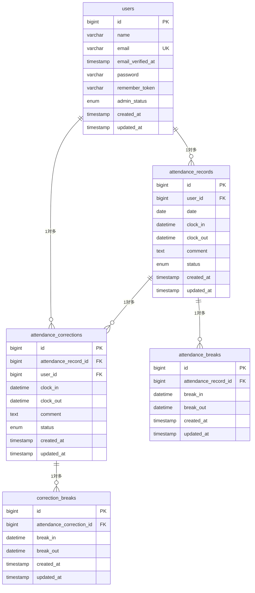

# attendance-app

## 概要

勤怠管理アプリケーションです。

一般ユーザーの日常的な打刻・修正申請機能、管理者による勤怠確認・CSV出力・APIが網羅されたシステムです。

## 主な機能

- **ユーザー認証**：Fortify / Sanctum / メール認証対応
- **打刻機能**：出勤、休憩、退勤のステータス管理
- **修正申請**：勤怠修正の依頼と管理者による承認フロー
- **管理機能**：日次・月次一覧確認、CSV出力
- **統計レポート**：労働・残業時間サマリー、異常検知
- **公開REST API**：勤怠データのCRUD操作

## 環境構築

1. リポジトリのクローンと移動

```bash
git clone https://github.com/hayashi-hiroyuki40/attendance-app.git

cd attendance-app
```

2. Composer パッケージのインストール

```bash
docker run --rm \
  -u "$(id -u):$(id -g)" \
  -v "$(pwd):/var/www/html" \
  -w /var/www/html \
  -e COMPOSER_CACHE_DIR=/tmp/composer_cache \
  laravelsail/php82-composer:latest \
  composer install
```

3. 環境設定ファイルをコピー

```bash
cp .env.example .env
```

4. .env を編集
   .env ファイルを開き、データベース接続情報が以下と一致していることを確認します。

```bash
DB_CONNECTION=mysql
DB_HOST=mysql
DB_PORT=3306
DB_DATABASE=laravel
DB_USERNAME=sail
DB_PASSWORD=password

MAIL_MAILER=smtp
MAIL_HOST=mailpit
MAIL_PORT=1025
```

5. Dockerコンテナの起動

```bash
./vendor/bin/sail up -d
```

6. アプリケーションキー生成 & データベース構築

```Bash
./vendor/bin/sail artisan key:generate
./vendor/bin/sail artisan migrate --seed
```

※データベースを初期化（リセット）したい場合は以下を実行してください。

```Bash
./vendor/bin/sail artisan migrate:fresh --seed
```

7. フロントエンドのセットアップ

```Bash
# パッケージのインストール
./vendor/bin/sail npm install

# 開発サーバーの起動（実行したままにします）
./vendor/bin/sail npm run dev
```

## 使用技術

- OS
- PHP 8.5.12
- Laravel 10.x
- MySQL 8.4
- Nginx
- Vite, Tailwind CSS ^3.4.0
- Docker, Laravel Sail, phpMyAdmin, Laravel Sanctum
- Mailpit
- Git / GitHub
- PHPUnit
- REST API, JSON

## ER図



## APIエンドポイント一覧

| HTTPメソッド | URI                                             | 説明               |
| :----------- | :---------------------------------------------- | :----------------- |
| GET          | `/api/v1/attendance-records`                    | 勤怠一覧を取得する |
| GET          | `/api/v1/attendance-records/{attendanceRecord}` | 勤怠詳細を取得する |
| POST         | `/api/v1/attendance-records`                    | 勤怠を新規登録する |
| PUT          | `/api/v1/attendance-records/{attendanceRecord}` | 勤怠を更新する     |
| DELETE       | `/api/v1/attendance-records/{attendanceRecord}` | 勤怠を削除する     |

## テスト実行

```bash
./vendor/bin/sail artisan test
```

## 動作確認用URL

アプリケーションを起動後、以下のURLからアクセスしてください。

- **ログイン画面**: [http://localhost/login](http://localhost/login)
- **会員登録画面**: `http://localhost/register`

## ログイン情報（テスト・動作確認用）

### 1. 一般ユーザー（ユーザー1）

- **役割**: 一般ユーザー
- **名前 / メールアドレス**: `user1@example.com`
- **パスワード**: `password`
- **ステータス**: メール認証済み

### 2. 一般ユーザー（ユーザー2）

- **役割**: 一般ユーザー
- **名前 / メールアドレス**: `user2@example.com`
- **パスワード**: `password`
- **ステータス**: メール認証済み

### 3. 管理者ユーザー（ユーザー3）

- **役割**: 管理者ユーザー (`admin_status = true`)
- **メールアドレス**: `user3@example.com`
- **パスワード**: `password`
- **ステータス**: メール認証済み

## 作成者

林裕之
